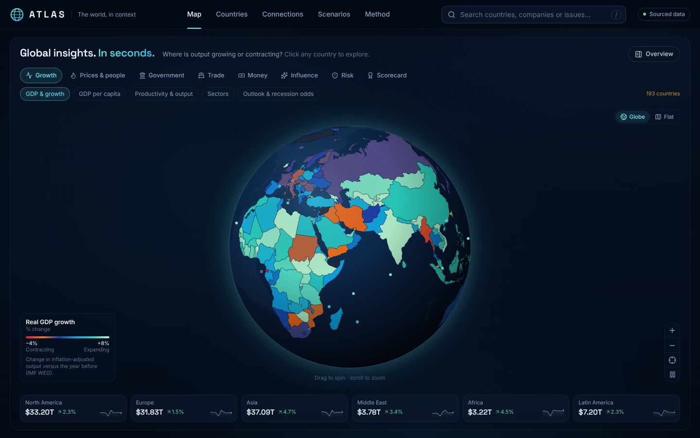

# ATLAS · The world, in context

A map-first command center for understanding a country's economy, its connections, and its exposure to global shocks.

Figures come from open sources fetched by scheduled GitHub Actions; every value carries its year. The News tab is still a placeholder.



**Live site:** https://liumoazed.github.io/world-view-made-ez/

## What's here

- **Full-width map** (D3 + Natural Earth): a drag-to-spin globe or flat map, colored by the selected subsection.
- **Seven sections, 33 subsections.** Each topic has one home: Growth, Prices & people, Government, Trade and Money say what the number is; Influence says who has leverage over whom; Risk scores how dangerous it is and cites the numbers above. A Scorecard section ranks countries on global indices.
- **Floating drawer.** The global overview and country views open in a translucent panel over the map's right edge (closed by default, Esc closes it). On phones it is a bottom sheet.
- **Country view.** A tab per section; each subsection lists its indicators with year, rank and source, plus trade partners (UN Comtrade), influence (FBIC) and the resilience score breakdown. Anything not fetched yet says so.

## Data

| Job | Script | Writes | Sources |
|---|---|---|---|
| `refresh-sections.yml` (weekly) | `scripts/fetch-sections.mjs` | `src/data/sections.json` | IMF WEO (DataMapper), World Bank WDI (incl. ILO, SIPRI, UCDP, WGI, debt statistics), BIS policy rates, OWID energy, Fragile States Index, ND-GAIN |
| `refresh-trade.yml` | `scripts/fetch-trade.mjs` | `src/data/trade.json` | UN Comtrade |
| `refresh-fbic.yml` | `scripts/fetch-fbic.mjs` | `src/data/influence.json` | FBIC Index (Pardee) |
| `refresh-indices.yml` | `scripts/fetch-indices.mjs` | `src/data/indices.json` | Scorecard indices |

`src/data/sections.ts` defines the sections, subsections, map scales and our own measures (trade balance, commodity exports, outlook band, resilience score). Not fetched yet: FBIC's economic and political strands, sanctions lists, alliance data, BIS cross-border banking, bilateral FDI and exchange-rate moves.

## Run it

```bash
npm install
npm run dev      # http://localhost:5173
npm run build    # type-check + production build
```

Every push to `main` builds and deploys to GitHub Pages via `.github/workflows/deploy.yml`.

Press `/` to jump to search.
