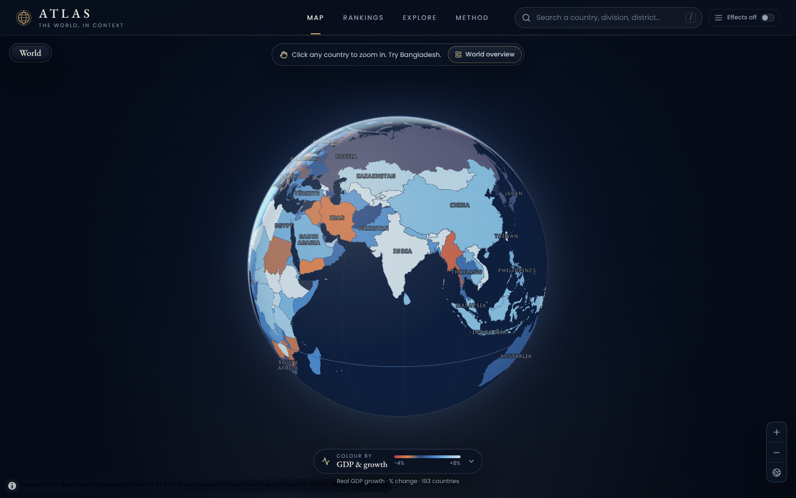

# ATLAS · The world, in context

A map-first command center for understanding a country's economy, its connections, and its exposure to global shocks.

Figures come from open sources fetched by scheduled GitHub Actions; every value carries its year. The News tab is still a placeholder.



**Live site:** https://liumoazed.github.io/world-view-made-ez/

## What's here

- **A real, zoomable map** (MapLibre GL on a globe). The home page is the map and little else. Click a country and the map flies in; its divisions or states become clickable, and each click goes one level down. Every country with published boundaries (194 of them) opens into its states or provinces and then its districts; Bangladesh goes one level further to upazilas and city areas, with roads and markets at street scale. The colour you pick stays on at every level. Measures marked "by region" colour each state or province with its own figure: human development (HDI, income, life expectancy, schooling), income growth, population density and the gender gap from the Global Data Lab, and conflict deaths from UCDP's geocoded events; other measures show the country's value there, marked "national". See [`public/geo/README.md`](public/geo/README.md).
- **Moving globe.** It turns slowly until you touch it; trade and influence links draw in as great-circle arcs with light flowing along them. The reduced-effects switch stops all of it.
- **One colour picker.** A single "Colour by" control at the bottom picks any of the subsections; its key sits in the same pill.
- **Place card.** A small card per place: three figures, the places inside it, and a link to the full profile.
- **Seven sections, 33 subsections.** Each topic has one home: Growth, Prices & people, Government, Trade and Money say what the number is; Influence says who has leverage over whom; Risk scores how dangerous it is and cites the numbers above. A Scorecard section ranks countries on global indices.
- **Full profile.** The global overview and country views open in a translucent panel over the map's right edge (Esc closes it). On phones it is a bottom sheet.
- **Pages.** Rankings, Explore and Method each have their own page (`#/rankings`, `#/explore`, `#/method`).
- **Country view.** A tab per section; each subsection lists its indicators with year, rank and source, plus trade partners (UN Comtrade), influence (FBIC) and the resilience score breakdown. Anything not fetched yet says so.

## Design system

Modern yet traditional, following the design brief: a full-screen navy map as the home page, ivory "paper" pages for reading (rankings, explore, method), and a dark footer.

- **Type.** EB Garamond for headlines and every key figure (lining, tabular numerals); a geometric sans for the interface, Century Gothic where installed and Poppins otherwise.
- **Color.** Navy base, ivory text, one warm accent (brass) for brand and editorial details, azure for active controls. Data colors share one family: garnet and copper for adverse, gold for caution, steel and azure for favorable.
- **Depth.** Soft gradients and shadows only on buttons, cards and the globe; content stays flat.
- **Tokens.** Everything reads CSS variables at the top of `src/styles.css`; `.paper` redefines them for light sections, so new sections just pick a surface.
- **Reduced effects.** A header switch (also in the footer) turns off the globe's spin, arc motion and glass blur. It follows the system's reduced-motion setting until changed (`src/effects.ts`).

## Data

| Job | Script | Writes | Sources |
|---|---|---|---|
| `refresh-sections.yml` (weekly) | `scripts/fetch-sections.mjs` | `src/data/sections.json` | IMF WEO (DataMapper), World Bank WDI (incl. ILO, SIPRI, UCDP, WGI, debt statistics), BIS policy rates, OWID energy, Fragile States Index, ND-GAIN |
| `refresh-trade.yml` | `scripts/fetch-trade.mjs` | `src/data/trade.json` | UN Comtrade |
| `refresh-fbic.yml` | `scripts/fetch-fbic.mjs` | `src/data/influence.json` | FBIC Index (Pardee) |
| `refresh-indices.yml` | `scripts/fetch-indices.mjs` | `src/data/indices.json` | Scorecard indices |
| `refresh-regional.yml` (monthly) | `scripts/fetch-regional.mjs` | `src/data/regional.json` | Global Data Lab Subnational HDI (SHDI v8.1, via its PRIO mirror), matched to the map's regions by name plus the hand-made table in `scripts/regional-groups.mjs`; UCDP GED conflict events via `scripts/fetch-conflict.mjs` into `src/data/conflict-regional.json` |

`src/data/sections.ts` defines the sections, subsections, map scales and our own measures (trade balance, commodity exports, outlook band, resilience score). Not fetched yet: FBIC's economic and political strands, sanctions lists, alliance data, BIS cross-border banking, bilateral FDI and exchange-rate moves.

## Run it

```bash
npm install
npm run dev      # http://localhost:5173
npm run build    # type-check + production build
```

Every push to `main` builds and deploys to GitHub Pages via `.github/workflows/deploy.yml`.

Press `/` to jump to search.
